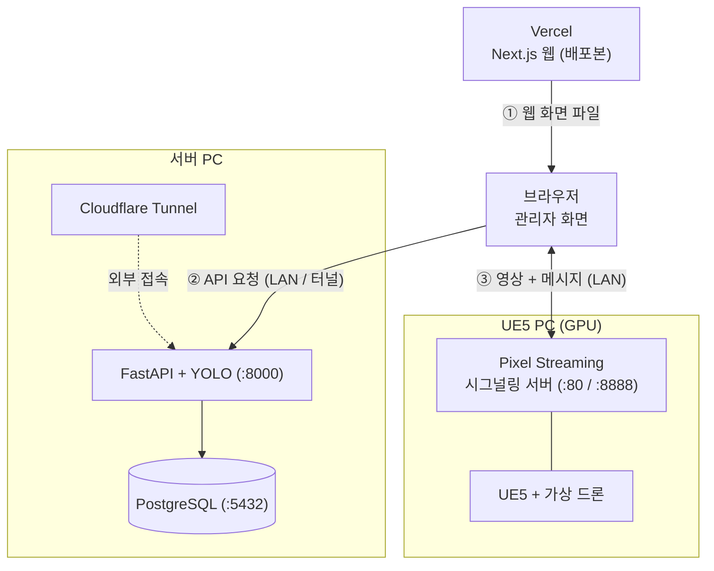
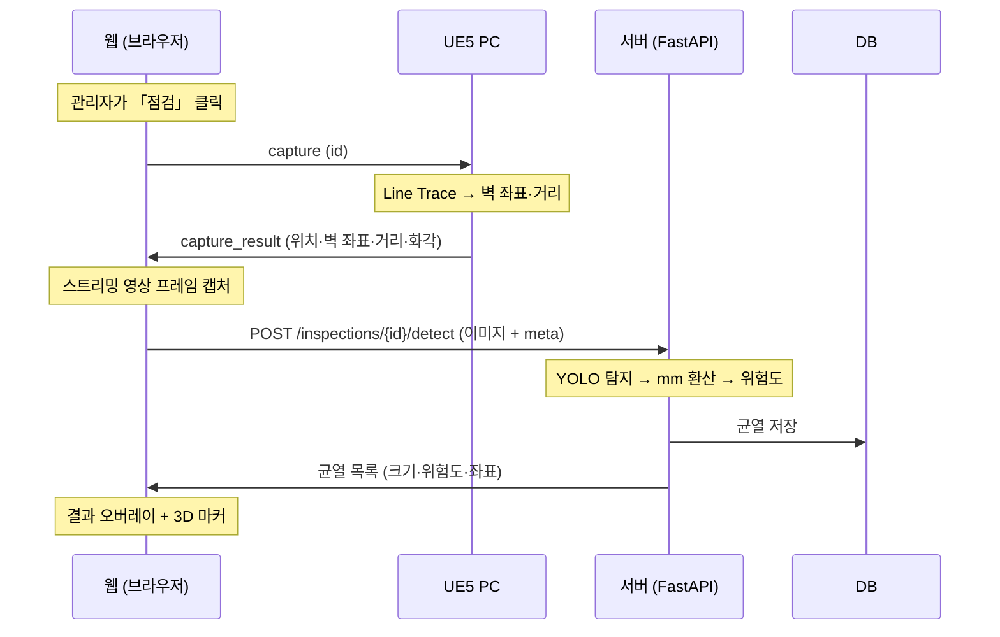
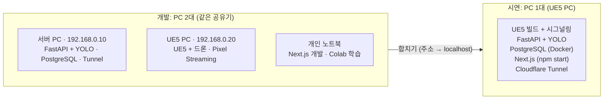
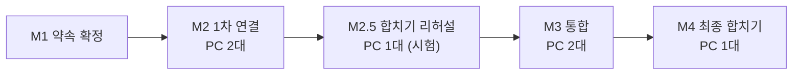
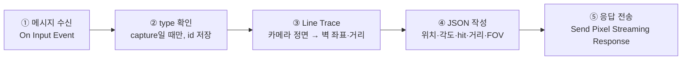

# 디지털 트윈팀 개발 문서

> 강원대학교 AI 아이디어콘 · 웹서비스 트랙
> 디지털 트윈 기반 구조물 균열 관리 웹서비스
>
> **구성:** 1. 공통 규칙 (두 팀 공통) → 2. 디지털 트윈팀 개발 플랜
> **팀원:** ① 모델링·에셋 ____ / ② UE5 엔진 ____


## 1. 공통 규칙 (두 팀 공통)

> 이 섹션은 디지털 트윈팀·시스템팀 문서에 **똑같이** 들어갑니다.
> 바꿀 때는 두 팀이 합의한 뒤 양쪽 문서를 함께 고칩니다.

### 1-1. 서비스 개요

| 항목 | 내용 |
|---|---|
| 서비스 | 디지털 트윈 기반 균열 감지 AI 모델을 도입한 구조물 균열 관리자 웹서비스 |
| 대회 | 강원대학교 AI 아이디어콘 · 웹서비스 트랙 |
| 문제 | 구조물 균열 점검이 육안에 의존 → 위험하고, 누락이 잦고, 이력 관리가 어려움 |
| 해결 | 가상 드론이 촬영 → AI(CV)가 균열 탐지·크기 측정·위험도 판정 → 웹의 3D 구조물 위에 시각화 |
| 팀 | 디지털 트윈팀 2인 (모델링·에셋 / UE5 엔진) · 시스템팀 3인 (AI / 백엔드 / 프론트) |

### 1-2. 시스템 개요도



- **Vercel은 웹 화면 파일만** 내려줍니다. 데이터 통신은 브라우저가 직접 합니다.
- **서버 PC와 UE5 PC는 직접 통신하지 않습니다.** 점검할 때 브라우저가 UE5에서 받은 화면과 좌표를 서버로 전달합니다.
- **드론 점검 화면은 로컬 Next.js(`http://localhost:3000`)에서만** 엽니다. Vercel의 https 페이지에서는 내부망 `ws://` 연결이 차단되기 때문입니다.
- **Vercel 배포본은 대시보드(목록, 3D 마커) 확인용**이며, 터널 주소로 서버에 접속합니다.

### 1-3. 개발 규칙

| # | 규칙 | 이유 |
|---|---|---|
| 1 | **주소(IP·포트·URL)는 코드에 쓰지 않고 `.env`에만** 둔다 | 합칠 때 설정만 바꾸면 됨 |
| 2 | **DB는 항상 서버와 같은 PC** (`localhost:5432`) | PC 2대·1대 구성에서 서버 설정이 같음 |
| 3 | **PostgreSQL은 Docker Compose로 실행** | 어느 PC에서나 명령 한 줄로 재현 |
| 4 | **UE5·Python·Node.js 버전을 전원 동일하게** 고정 | 환경 차이로 생기는 오류 방지 |
| 5 | `requirements.txt`, `package-lock.json`을 **버전 고정 후 커밋** | 라이브러리 차이 방지 |
| 6 | 시연 데이터는 **`seed.py`로만 생성** (DB 직접 수정 금지) | 새 PC에서도 같은 데이터 |
| 7 | AI 실행 장치는 `.env`의 `DEVICE`(`cpu` / `cuda`)로 전환 | 합친 뒤 GPU를 UE5와 나눠 쓸지 선택 |
| 8 | **비밀값(API 키 등)은 `.env`에만**, Git 커밋 금지, `NEXT_PUBLIC_` 금지 | 노출 방지 |
| 9 | **좌표는 DB·API에서 UE5 좌표(cm) 그대로**, 변환은 웹에서만 | 변환하는 곳을 한 곳으로 고정 |
| 10 | 메시지·API 형식 변경은 **양 팀 합의 후 이 문서를 먼저 수정** | 연결 오류 방지 |
| 11 | JSON 필드는 `camelCase`, DB 컬럼은 `snake_case` | 이름 혼동 방지 |
| 12 | UE5 프로젝트 이름과 경로는 **영문만** (예: `D:\dev\CrackTwin`) | 한글 경로 빌드 오류 방지 |

**버전 표 (첫 회의에서 확정 후 기입)**

| 항목 | 버전 |
|---|---|
| Unreal Engine | 5.__ (전원 동일) |
| Python | 3.11 또는 3.12 중 택1: ____ |
| Node.js | 22 LTS 이상: ____ |
| PostgreSQL | 16 이상 (Docker 이미지): ____ |
| Ultralytics (YOLO) | ____ |

**공유 위치**

| 대상 | 위치 | 규칙 |
|---|---|---|
| 코드 (`web`, `server`, `ai`, `scripts`) | GitHub 모노레포 | 기능 브랜치에서 작업 → `main`에 병합 |
| UE5 프로젝트 | Google Drive `/ue5` | `CrackTwin_YYYYMMDD_v번호.zip`, **Git 금지** (용량) |
| AI 모델 `best.pt` | Google Drive `/models` | 파일명에 날짜와 mAP 기록 (예: `best_1108_map72.pt`) |
| 3D 모델 `.glb`, 균열 사진 | Google Drive `/assets` | 사진 출처 목록 함께 보관 |
| 이 문서 | GitHub `/docs` | 변경 시 커밋 메시지에 변경 내용 기록 |

### 1-4. 연결 약속

#### ① Pixel Streaming 메시지 (웹 ↔ UE5)

드론 이동(키보드·마우스)은 Pixel Streaming이 UE5에 그대로 전달하므로 **별도 메시지가 없습니다.**

| 방향 | `type` | 용도 |
|---|---|---|
| 웹 → UE5 | `capture` | 점검 요청 |
| UE5 → 웹 | `capture_result` | 드론 위치·각도, 카메라가 가리키는 벽면 좌표, 벽까지 거리, 화각 |
| 웹 → UE5 (선택) | `goto` | 대시보드에서 고른 균열 위치로 드론 이동 |

```json
// 웹 → UE5
{ "type": "capture", "id": "c-0001" }

// UE5 → 웹
{
  "type": "capture_result",
  "id": "c-0001",
  "structureId": 1,
  "drone": { "x": 820.0, "y": -150.0, "z": 400.0, "yaw": 90.0, "pitch": -5.0 },
  "hit":   { "x": 1250.0, "y": -150.0, "z": 380.0 },
  "hitOk": true,
  "distanceCm": 430.0,
  "fovDeg": 90.0
}

// 웹 → UE5 (선택)
{ "type": "goto", "x": 1250.0, "y": -150.0, "z": 380.0 }
```

| 필드 | 설명 |
|---|---|
| `id` | 웹이 만든 요청 번호. UE5는 받은 값을 그대로 돌려줌 |
| `structureId` | 레벨에 설정된 구조물 번호 (시연은 `1`) |
| `drone` | 드론 위치(cm), `yaw`·`pitch` 각도(도) |
| `hit` | 카메라 정면으로 쏜 Line Trace가 벽에 맞은 좌표(cm) |
| `hitOk` | 벽에 안 맞으면 `false` → 웹은 「구조물을 향해 주세요」 표시 |
| `distanceCm` | 카메라에서 벽까지 거리(cm) → **균열 크기를 mm로 환산할 때 사용** |
| `fovDeg` | 카메라 **가로** 화각(도) |

#### ② API (웹 ↔ 서버)

| 메서드 | 경로 | 설명 |
|---|---|---|
| GET | `/health` | 서버 상태 확인 |
| GET | `/structures` | 구조물 목록 (위험도별 균열 수 포함) |
| GET | `/structures/{id}` | 구조물 상세 (`modelUrl` 포함) |
| POST | `/inspections` | 점검 시작 `{ "structureId": 1 }` → `{ "id": 3 }` |
| POST | `/inspections/{id}/detect` | 이미지 + 메타데이터 → 균열 결과 |
| GET | `/structures/{id}/cracks?severity=danger` | 구조물의 균열 목록 (위험도 필터 선택) |
| GET | `/cracks/{id}` | 균열 상세 |
| GET | `/files/...` | 이미지·3D 모델 파일 |

**`POST /inspections/{id}/detect`**
- 요청: `multipart/form-data`
  - `image`: JPG 파일 (스트리밍 화면 캡처)
  - `meta`: `capture_result` JSON 문자열 그대로
- 응답:

```json
{
  "inspectionId": 3,
  "cracks": [
    {
      "id": 12,
      "severity": "caution",
      "confidence": 0.87,
      "lengthMm": 420.5,
      "widthMm": 1.8,
      "areaMm2": 756.9,
      "pos": { "x": 1250.0, "y": -150.0, "z": 380.0 },
      "bbox": [812, 400, 1104, 690],
      "imageUrl": "/files/captures/3/c-0001_orig.jpg",
      "overlayUrl": "/files/captures/3/c-0001_overlay.jpg"
    }
  ]
}
```

- `severity`: `safe`(양호, 초록) · `caution`(주의, 노랑) · `danger`(위험, 빨강)
- `pos`: MVP에서는 `hit` 좌표를 그 화면의 모든 균열에 사용합니다. 균열마다 다른 위치를 쓰는 기능은 선택 사항입니다.
- 균열이 없으면 `"cracks": []`

#### ③ 좌표계

| 구분 | UE5 | Three.js (웹) |
|---|---|---|
| 단위 | cm | m |
| 위쪽 축 | Z | Y |
| 좌표계 | 왼손 좌표계 | 오른손 좌표계 |

- **저장:** DB와 API는 UE5 좌표(cm)를 그대로 씁니다.
- **변환:** 웹의 `ueToThree()` 함수 한 곳에서만 합니다. 출발점으로 쓸 공식은 `(x, z, y) ÷ 100`입니다. 축 2개를 맞바꾸면 왼손·오른손 좌표계 차이가 해결됩니다.
- **검증:** glTF 내보내기 설정에 따라 축과 배율이 달라질 수 있습니다. **기준점 3개**(원점, 건물 모서리 A·B)로 반드시 확인합니다. 디지털 트윈팀이 UE5 좌표를 주고, 시스템팀이 웹에서 확인합니다.

#### 점검 흐름



### 1-5. PC 구성: 개발은 2대, 시연은 1대



**IP와 포트**

| PC | 고정 IP (예시) | 열어야 할 포트 |
|---|---|---|
| 서버 PC | `192.168.0.10` | 8000 (API) |
| UE5 PC | `192.168.0.20` | 80 (웹 플레이어·시그널링), 8888 (스트리머), WebRTC (UDP) |
| 시연 PC (1대) | — | 외부 공개 불필요 (터널만 사용) |

> 80번 포트를 다른 프로그램이 쓰고 있으면 시그널링 서버 포트를 바꾸고, 시스템팀에 `NEXT_PUBLIC_PS_URL` 변경을 알립니다.

**설정 파일: 합칠 때 바뀌는 것은 웹 주소 2개뿐입니다.**

| 파일 | 항목 | PC 2대 | PC 1대 |
|---|---|---|---|
| `web/.env.local` | `NEXT_PUBLIC_API_URL` | `http://192.168.0.10:8000` | `http://localhost:8000` |
| `web/.env.local` | `NEXT_PUBLIC_PS_URL` | `ws://192.168.0.20` | `ws://localhost` |
| Vercel 환경변수 | `NEXT_PUBLIC_API_URL` | 서버 PC 터널 주소 | UE5 PC 터널 주소 |
| `server/.env` | 전부 | 그대로 | 그대로 |

> ⚠️ `NEXT_PUBLIC_` 값은 **빌드할 때 코드에 박힙니다.** 값을 바꾸면 반드시 다시 빌드합니다 (`npm run build` 또는 `vercel --prod`).

### 1-6. 마일스톤



| 마일스톤 | 내용 | 완료 확인 | 날짜 |
|---|---|---|---|
| **M1 약속 확정** | 이 문서의 공통 규칙, 버전 표, DB, 화면 스케치 | 전원 문서 확인 | ____ |
| **M2 1차 연결** | 가짜 데이터로 UE5 → 웹 → API → DB 흐름 완성 | 「점검」 클릭 시 DB에 행 1개 생성 | ____ |
| **M2.5 합치기 리허설** | UE5 PC에 서버를 시험 설치, 동시 실행 성능 확인 | 1대에서 M2 흐름 성공 | ____ |
| **M3 통합** | 실제 씬과 실제 AI 모델로 교체 | 시연 시나리오 1회 성공 | ____ |
| **M4 최종 합치기** | 1대로 합치기, 시연 영상 녹화, 발표 리허설 | 최종 체크리스트 통과 | ____ |

### 1-7. 합치기·비상 규칙

- **합치기 리허설은 M2 직후에 합니다.** 마지막 날 처음 합치지 않습니다.
- **합치기 총괄:** UE5 담당 + 백엔드 담당
- **합친 뒤에는 코드를 동결합니다.** 꼭 필요한 수정만 하고, 수정은 `git pull` 후 다시 빌드하는 방식으로만 반영합니다.
- **PC 2대 구성은 발표가 끝날 때까지 지우지 않습니다.** 문제가 생기면 `web/.env.local`만 2대용으로 되돌려 다시 빌드합니다.
- **공유기나 휴대폰 핫스팟을 챙깁니다.** 대회장 와이파이는 기기끼리 통신을 막아 두는 경우가 많습니다.
- **시연 영상은 1대 구성에서 OBS로 녹화합니다.** 스트리밍이 실패하면 UE5 화면과 웹 화면을 따로 녹화해 편집합니다.


---

## 2. 디지털 트윈팀 개발 플랜

### 2-1. 목표와 결과물

**목표:** 웹에서 조종할 수 있는 가상 드론과, 실제 균열 사진으로 균열을 배치한 구조물 UE5 가상환경을 만든다.

| 결과물 | 마감 | 받는 사람 |
|---|---|---|
| UE5 스크린샷 30~50장 (AI 탐지 테스트용) | M2 전 | 시스템팀 AI |
| `capture` → `capture_result` 동작 | M2 | 시스템팀 프론트 |
| 구조물 `.glb` + 기준점 3개 좌표 | M3 | 시스템팀 프론트 |
| 균열 「정답 위치 목록」 | M3 | 시스템팀 AI·전원 |
| UE5 프로젝트 + 패키징 빌드 | M4 | 전원 (시연) |
| 시연용 드론 비행 동선 | M4 | 전원 (영상) |

### 2-2. 역할

| 담당 | 업무 |
|---|---|
| **① 모델링·에셋** | 구조물 3D 모델 (Tripo3D, 품질이 부족하면 Fab 무료 에셋), 벽 텍스처 (GPT), **균열 데칼**, `.glb` 내보내기, 「정답 위치 목록」 |
| **② UE5 엔진** | 씬 구성, 드론, Pixel Streaming, `capture` 처리, 패키징, UE5 PC 관리, **합치기 총괄** (백엔드 담당과 함께) |

### 2-3. 개발 환경 (UE5 PC)

- [ ] UE5 설치 (버전 표와 동일), 그래픽 드라이버 최신화
- [ ] 프로젝트를 영문 경로에 생성 (예: `D:\dev\CrackTwin`)
- [ ] 플러그인 활성화: **Pixel Streaming**, **glTF Exporter**
- [ ] UE 버전에 맞는 **시그널링 서버** 준비 (Epic 공식 Pixel Streaming Infrastructure)
- [ ] IP 고정 `192.168.0.20`, 방화벽에서 80·8888 포트와 WebRTC(UDP) 허용
- [ ] 레벨에 변수 `StructureId = 1` 설정

### 2-4. 단계별 할 일

| 단계 | ① 모델링·에셋 | ② UE5 엔진 | 완료 확인 |
|---|---|---|---|
| **M1 약속 확정** | 구조물 종류 결정 (건물 외벽 / 교량 / 터널 중 1개 추천) | UE5 버전 확정, Pixel Streaming 테스트 | 공통 규칙 합의 |
| **기본 제작** | 구조물 모델 생성, 벽 텍스처 | 씬(지형·조명), 드론 Pawn, 키 조작 | 에디터에서 드론 비행 |
| **균열 배치** | 균열 데칼 제작·배치, 정답 목록 작성 시작 | 데칼이 각도·조명에 따라 잘 보이는지 점검 | 균열 8~10개 배치 |
| **M2 전** | **UE5 스크린샷 30~50장 → 시스템팀 AI** | — | AI팀 전달 완료 |
| **M2 1차 연결** | — | 브라우저 조종 성공, `capture` → `capture_result` | 웹 콘솔에 응답 출력 |
| **M2.5 리허설** | — | UE5 PC에 서버 시험 설치 지원, 동시 실행 시 FPS 측정 | 1대에서 M2 흐름 성공 |
| **웹용 3D** | `.glb` 내보내기, 폴리곤 줄이기 | 기준점 3개 좌표 제공, 웹 위치 비교 | 웹 마커 위치 일치 |
| **M3 통합** | 시연 동선에 맞게 균열 위치 조정, 정답 목록 확정 | `hitOk`·거리·화각 값 점검, (선택) `goto` | 시연 시나리오 1회 성공 |
| **M4 최종** | 시연 카메라 동선 정리 | 패키징 빌드, 실행 방법 문서화, 합치기 총괄 | 최종 체크리스트 통과 |

### 2-5. 균열 데칼 제작 가이드 (① 담당)


**규칙**
- **실제 균열 사진을 씁니다.** AI가 실제 사진으로 학습하기 때문입니다. GPT 생성 이미지는 벽 텍스처 같은 배경에만 씁니다.
- **균열 분포:** 위험 2~3개, 주의 3~4개, 양호 2~3개 (총 8~10개)
- **배치 위치:** 시연 동선 위에, 정면과 사선 모두에서 보이게 배치합니다.
- **데칼 크기를 cm 단위로 기록합니다.** 그러면 실제 균열 폭(mm)을 알 수 있어서, AI가 측정한 값과 비교할 수 있습니다. 발표 근거로 좋습니다.
- **사진 출처 기록:** AI Hub 데이터는 이용 조건을, Roboflow 데이터는 데이터셋별 라이선스를 확인합니다.

**「정답 위치 목록」 양식**

| 번호 | UE5 좌표 (x, y, z / cm) | 설정 위험도 | 데칼 기준 실제 폭 (mm) | AI 측정 폭 (mm) | 탐지 여부 | 사진 출처 |
|---|---|---|---|---|---|---|
| 1 | | | | (시스템팀 기입) | | |
| 2 | | | | | | |

**스크린샷 가이드 (AI 탐지 테스트용)**
- 30~50장, 해상도 1920×1080, PNG
- 벽까지 거리 2~10m, 정면과 사선 각도 섞기
- 조명 2~3종류 (낮, 흐림 등)
- 균열 없는 사진도 5장 이상 포함 (잘못 탐지하는지 확인용)
- 파일명: `ue5_거리m_각도_번호.png` (예: `ue5_4m_front_01.png`)

### 2-6. `capture` 처리 (② 담당, 블루프린트)



| 순서 | 내용 | 사용 노드 (UE 버전에 따라 이름이 조금 다를 수 있음) |
|---|---|---|
| 1 | 웹 메시지 받기 | **Pixel Streaming Input** 컴포넌트 → **On Input Event** 바인딩 |
| 2 | `type`이 `capture`인지 확인, `id` 저장 | **Get Json String Value** |
| 3 | 카메라 위치에서 정면 방향 100m까지 선 쏘기 | **Line Trace By Channel** (시작 = 카메라 위치, 끝 = 시작 + Forward Vector × 10000) |
| 4 | 맞았으면 `hit` = Hit Location, `distanceCm` = Distance / 안 맞았으면 `hitOk = false` | Break Hit Result |
| 5 | `fovDeg` = 카메라 컴포넌트의 **Field Of View** (가로 화각) | Get Field Of View |
| 6 | JSON 문자열 만들기 (1-4 ① 형식 그대로) | Format Text 또는 Append |
| 7 | 웹으로 보내기 | **Send Pixel Streaming Response** |

**주의**
- 숫자는 따옴표 없이 숫자로 보냅니다 (`"distanceCm": 430.0`).
- 소수점은 1자리로 반올림합니다.
- 필드 이름은 1-4 ① 표와 **글자 하나까지 똑같이** 씁니다.

### 2-7. 드론 조작 (② 담당)

| 항목 | 설정 |
|---|---|
| 구조 | Pawn + **Floating Pawn Movement** + 1인칭 카메라 |
| 키 | W/S 앞뒤 · A/D 좌우 · E 상승 · Q 하강 · 마우스로 시점 |
| 속도 | 시연 영상에서 보기 좋게 느리게 (최대 3~5m/s 정도) |
| 충돌 | 켜기 (벽 통과 금지) |
| 시작 위치 | 구조물 정면 약 5m 지점 |

> 키 배치는 시스템팀 프론트 담당에게 공유합니다. 드론 점검 화면의 안내문에 들어갑니다.

### 2-8. Pixel Streaming 설정 (② 담당)

1. Pixel Streaming 플러그인 활성화 → 에디터 재시작
2. 시그널링 서버 실행 (웹 플레이어 80번, 스트리머 8888번)
3. 에디터 테스트: **Standalone Game**으로 실행하고, 추가 실행 인자에 `-PixelStreamingURL=ws://127.0.0.1:8888` 입력
4. 같은 PC 브라우저에서 `http://localhost` 확인 → 다른 PC에서 `http://192.168.0.20` 확인
5. 패키징 빌드 실행 예:

```bat
CrackTwin.exe -PixelStreamingURL=ws://127.0.0.1:8888 -ResX=1920 -ResY=1080 -Windowed
```

> 실행 인자 이름은 UE 버전에 따라 다를 수 있습니다. 설치한 버전의 공식 문서를 확인하세요.

### 2-9. `.glb` 내보내기와 좌표 검증 (① + ②)

- 구조물 기준점을 **UE5 원점 (0, 0, 0)** 에 맞춥니다. 좌표 맞추기가 훨씬 쉬워집니다.
- 구조물만 선택 → glTF Exporter → `structure.glb`
- 웹용이므로 폴리곤을 줄입니다 (파일 20MB 이하 목표).
- 아래 기준점 표를 채워 시스템팀에 전달합니다.

| 기준점 | UE5 좌표 (x, y, z / cm) | 웹 위치 일치 (시스템팀 확인) |
|---|---|---|
| 원점 | 0, 0, 0 | ☐ |
| 모서리 A | | ☐ |
| 모서리 B | | ☐ |

### 2-10. 시스템팀과 주고받는 것

| 시점 | 디지털 트윈팀 → 시스템팀 | 시스템팀 → 디지털 트윈팀 |
|---|---|---|
| M1 | 구조물 종류, 키 배치 | 메시지·API 최종본 |
| M2 전 | UE5 스크린샷 30~50장 | 탐지 테스트 결과 (잘 안 잡히는 균열 목록) |
| M2 | `capture_result` 동작 | 드론 점검 화면 (테스트용) |
| M3 | `.glb`, 기준점 3개, 정답 목록 | 좌표 검증 결과, AI 측정 폭 |
| M4 | 패키징 빌드 | 시작 스크립트 (`start_demo.ps1`) |

### 2-11. 위험과 대비책

| 위험 | 대비책 |
|---|---|
| UE5 화면의 균열을 AI가 못 잡음 | 스크린샷을 일찍 전달 → 시스템팀이 추가 학습. 데칼 대비(명암)와 크기 조정 |
| Tripo3D 모델 품질 부족 | Fab 무료 건물 에셋이나 기본 도형으로 대체 |
| Pixel Streaming 연결 실패 | 시그널링 서버 포트·방화벽 확인. 최악의 경우 UE5 화면을 직접 녹화 |
| 1대 구성에서 FPS 저하 | 그림자·해상도 품질 낮추기, YOLO는 `DEVICE=cpu`로 |
| `.glb` 위치·축 불일치 | 기준점 3개로 검증, 원점 맞추기 |

### 2-12. 완료 체크리스트

- [ ] 웹 브라우저에서 드론을 조종할 수 있다
- [ ] `capture` 요청에 `capture_result`가 형식대로 돌아온다
- [ ] 하늘을 보고 점검하면 `hitOk: false`가 온다
- [ ] 균열 8~10개 배치, 정답 목록 완성
- [ ] `.glb`의 웹 위치가 기준점 3개와 일치한다
- [ ] 패키징 빌드가 UE5 PC에서 실행된다
- [ ] 1대 구성에서 서버와 동시 실행해도 시연 가능한 FPS가 나온다
